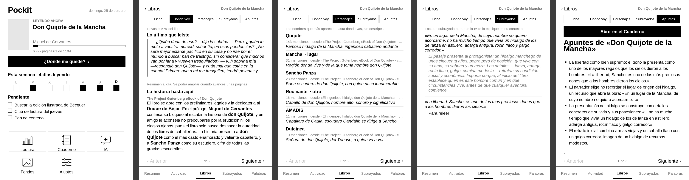

# Pockit · el centro de lectura de tu PocketBook

**Mejora tu PocketBook de fábrica, sin jailbreak ni root.** Una app nativa que se instala con un clic desde [pockit.yous.dev](https://pockit.yous.dev) y lleva al lector lo que le falta, con IA que gasta céntimos por libro.

*English: a native “reading hub” for PocketBook e‑readers — reading stats, a book card with where you left off and who's who, tagged Markdown notes synced through the reader's own Dropbox, an optional AI agent that knows your books, highlights and notes, and sleep‑screen wallpapers. No jailbreak; install it from the web with one click.*



## Qué trae

| Módulo | Qué hace |
|---|---|
| **Inicio** | Lo que estás leyendo, tu semana y acceso a todo. Nada más: Pockit no te reclama nada. |
| **Lectura** | Estadísticas, calendario de actividad, subrayados y tarjetas de vocabulario. Cada libro tiene su ficha: **Dónde voy** (lo último que leíste y la historia hasta aquí), **Personajes** (quién sale, con quién y dónde, sin destripes) y **Notas** (tus subrayados y las notas del Cuaderno con su etiqueta). |
| **Cuaderno** | Notas y tareas en Markdown con un teclado en español. `#etiquetas` para filtrar; la de un libro (`#niebla`) enlaza la nota con su ficha. |
| **Pockit AI** | Opcional. Un asistente con herramientas que mira tus libros, subrayados, notas y tareas, te recuerda lo leído, guarda quién es quién, toma apuntes, hace exámenes y busca en internet. Enseña cada paso, lo que gasta y los errores. |
| **Fondos** | Cambia el fondo de reposo desde el lector, con transparencia. |
| **Ajustes** | Dónde se guardan tus datos (el lector o Dropbox), Pockit AI y actualizaciones desde el propio lector. |

Y aparte, con su propio icono para abrirlo de un toque, el **Modo bolsillo**: música o audiolibros con el lector en el bolsillo, la luz apagada y el táctil bloqueado.

## Tus datos, en el lector o en Dropbox

Tus notas, chats y lo que Pockit sabe de cada libro son texto, en una carpeta `Pockit/`. En **Ajustes → Sincronizar con Dropbox** pasan a `Dropbox PocketBook/Pockit/`, y la sincronización de Dropbox que ya trae el lector los sube a tu cuenta cuando hay wifi (sin conexión se guardan igual). Antes de mover nada se guarda una copia en el lector.

Cada libro se reconoce por su título, no por su archivo: si lo borras, lo mueves o bajas otra edición, sus resúmenes, sus personajes y tus notas siguen ahí, y la ficha guarda sus datos aunque ya no esté en el lector.

## Pockit AI, sin reclamar tu atención

Todo Pockit funciona sin IA, y ningún módulo tiene botones de IA. La IA vive en su app y trabaja **sobre** los demás módulos: lee tus libros, subrayados, notas y estadísticas, y lo que averigua lo deja donde corresponde (el resumen en *Dónde voy*, quién es alguien en *Personajes*, los apuntes en el Cuaderno con la etiqueta del libro). Se lo pides con tus palabras; no hay acciones fijas. Detalles en [docs/pockit-ai.md](docs/pockit-ai.md).

- **Sin IA y gratis** (`common/epub.h`): el lector abre el ePub, saca el texto por capítulos, sabe hasta qué carácter has leído (un poco antes, para no destripar), quita índices, listas y avisos legales, y encuentra los personajes: nombres propios que se repiten en mitad de frase, con quién salen y dónde aparecen; separa los lugares («en París») y las cosas («la Historia»).
- **Frugal**: cada trozo del libro se resume **una sola vez en la vida**; prompt y herramientas fijos para que el proveedor los cachee; resultados recortados. Una consulta normal con herramientas cuesta en torno a **0,001 $**.
- **Con frenos**: no repite consultas, tiene un tope de lectura y de gasto por pregunta, y si no llega a una respuesta lo dice; nunca falla en silencio.
- **Sin spoilers**: las herramientas no pasan de tu posición salvo que lo pidas, y se le prohíbe usar lo que sepa del libro por su cuenta.

## Instalar

1. Abre **[pockit.yous.dev](https://pockit.yous.dev)** en Chrome, Edge o Brave y conecta el lector por USB.
2. **Tu lector → Apps** → *Instalar* Pockit (y, si quieres, el Modo bolsillo).
3. Para la IA, pega ahí mismo tu clave de DeepSeek.

La web elige la versión de tu modelo, copia la app y su icono y la añade al menú de Aplicaciones. Nada de carpetas.

<details>
<summary>A mano</summary>

Descarga de la rama [`dist`](../../tree/dist) el `.app` de tu plataforma (`B288` para Verse, Verse Pro, Era, InkPad…; `RK3566` para el PocketBook Q) y cópialo a la carpeta `applications` del lector como `Pockit.app`. Aparecerá en Aplicaciones.
</details>

## Compilar

Solo hace falta [zig](https://ziglang.org) (0.17):

```bash
make
```

Descarga las cabeceras de InkView y deja en `dist/` las apps para las dos plataformas. Cada vez que se sube algo a `main`, GitHub Actions las compila y las publica en la rama `dist`, de donde las descarga la web.

### Emulador

Para ver las apps sin el lector (con Docker):

```bash
emulator/prepare.py
APPARGS="inicio" emulator/run.sh apps/pockit captura.png
```

Usa el emulador x86‑64 que trae el SDK de PocketBook y datos de ejemplo con libros de dominio público (el Quijote de Project Gutenberg).

## Cómo está hecho

- **C contra InkView**, la librería con la que PocketBook hace sus apps. No hay root ni se modifica el sistema: las apps viven en `applications/`, tus datos en `Pockit/` (o en la carpeta de Dropbox) y la caché en `system/config/pockit`.
- **`apps/pockit`**: una sola app con módulos (`pockit.h`); `main.c` reparte los eventos de InkView al módulo activo.
- **Lectura** solo lee las bases de datos del lector; el estado del vocabulario y la caché de la IA van a archivos propios.
- **`apps/pockit/datos.c`**: dónde viven tus datos, la mudanza a Dropbox, las etiquetas y la identidad de cada libro.
- **`common/`**: `md.h` (Markdown), `ai.h` (proveedor compatible con OpenAI, precios y gasto), `json.h`, `epub.h` (texto, posición y personajes sin IA) y `stb_image.h` (dominio público: fondos y descompresión de los ePub).

## Créditos

- Cabeceras y documentación de InkView: [ssttevee/libinkview](https://github.com/ssttevee/libinkview).
- Emulador: SDK de PocketBook, vía [Sean-on-Git/PocketBook-SDK](https://github.com/Sean-on-Git/PocketBook-SDK).
- Decodificador de imágenes y de zip: [stb_image](https://github.com/nothings/stb) (dominio público).
- Licencia MIT.

PocketBook es una marca de PocketBook International SA. Este proyecto no está afiliado a PocketBook.
