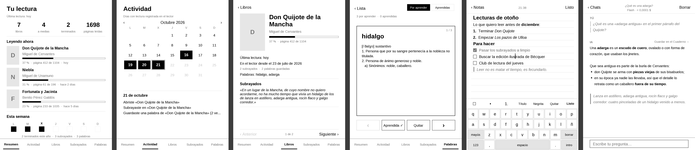

# Pockit · apps para tu PocketBook

**Mejora tu PocketBook de fábrica, sin jailbreak ni root.** Cuatro apps nativas que se instalan con un clic desde [pockit.yous.dev](https://pockit.yous.dev) y se usan como las del sistema.

*English: native apps for PocketBook e‑readers (notes, AI chat, reading stats and a “pocket mode” for music). No jailbreak; install them from the web with one click.*



| App | Qué hace |
|---|---|
| **Cuaderno** | Notas y listas de tareas en Markdown sobre papel pautado. Se escribe en la propia nota con un teclado en español: Intro continúa la lista, ☐ convierte la línea en tarea. Todo se guarda como `.md` en la carpeta `Notas`. |
| **IA** | Pregunta dudas o pasajes a DeepSeek, con historial de chats, respuestas con formato y su coste. Cualquier respuesta se guarda en el Cuaderno. Necesita tu propia clave de DeepSeek. |
| **Lectura** | Tus estadísticas sin conectar el lector: progreso, calendario de actividad, ficha de cada libro, subrayados y tarjetas de vocabulario con las palabras que guardas del diccionario. |
| **Modo bolsillo** | Para escuchar música o audiolibros con el lector en el bolsillo: tu fondo de reposo, la canción que suena, la luz apagada y el táctil bloqueado. Bloquear el lector corta el audio USB; esto no. |

## Instalar

1. Abre **[pockit.yous.dev](https://pockit.yous.dev)** en Chrome, Edge o Brave y conecta el lector por USB.
2. **Tu lector → Apps** → *Instalar*.

La web elige la versión de tu modelo, copia la app y su icono y la añade al menú de Aplicaciones. Nada de carpetas.

<details>
<summary>A mano</summary>

Descarga de la rama [`dist`](../../tree/dist) el `.app` de tu plataforma (`B288` para Verse, Verse Pro, Era, InkPad…; `RK3566` para el PocketBook Q) y cópialo a la carpeta `applications` del lector con el nombre de `apps.json` (por ejemplo `Cuaderno.app`). Aparecerá en Aplicaciones.
</details>

## Compilar

Solo hace falta [zig](https://ziglang.org) (0.17):

```bash
make
```

Descarga las cabeceras de InkView y deja en `dist/` las apps para las dos plataformas. Cada vez que se sube algo a `main`, GitHub Actions las compila y las publica en la rama `dist`, de donde las descarga la web.

### Emulador

Para ver las apps sin el lector (con Docker):

```bash
emulator/prepare.py
emulator/run.sh apps/cuaderno/cuaderno.c captura.png
```

Usa el emulador x86‑64 que trae el SDK de PocketBook y datos de ejemplo con libros de dominio público.

## Cómo está hecho

- **C contra InkView**, la librería con la que PocketBook hace sus apps. No hay root ni se modifica el sistema: las apps viven en `applications/` y sus datos en carpetas normales (`Notas`, `Chats`).
- **Lectura** solo lee las bases de datos del lector; el estado del vocabulario va a un archivo propio.
- **`common/md.h`** pinta el Markdown que comparten el Cuaderno y la IA.

## Créditos

- Cabeceras y documentación de InkView: [ssttevee/libinkview](https://github.com/ssttevee/libinkview).
- Emulador: SDK de PocketBook, vía [Sean-on-Git/PocketBook-SDK](https://github.com/Sean-on-Git/PocketBook-SDK).
- Licencia MIT.

PocketBook es una marca de PocketBook International SA. Este proyecto no está afiliado a PocketBook.
