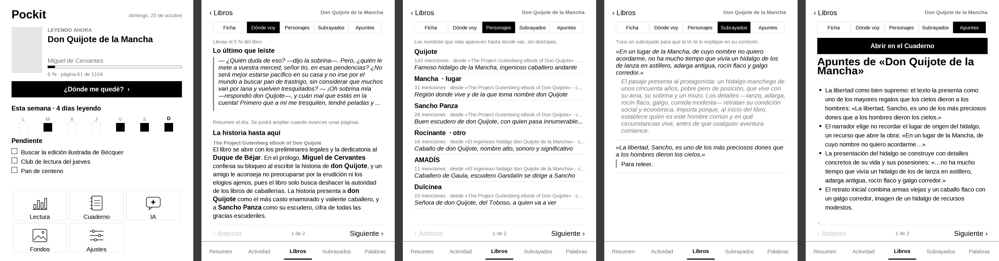

# Pockit · el centro de lectura de tu PocketBook

**Mejora tu PocketBook de fábrica, sin jailbreak ni root.** Una app nativa que se instala con un clic desde [pockit.yous.dev](https://pockit.yous.dev) y lleva al lector lo que le falta, con IA que gasta céntimos por libro.

*English: a native “reading hub” for PocketBook e‑readers — stats, spoiler‑free recaps, character lists, highlight explanations, notes, AI chat and sleep‑screen wallpapers. No jailbreak; install it from the web with one click. The AI is designed to be extremely token‑frugal.*



## Qué trae

| Módulo | Qué hace |
|---|---|
| **Inicio** | Lo que estás leyendo, tu semana, tus tareas pendientes y acceso a todo. |
| **Lectura** | Estadísticas, calendario de actividad, ficha de cada libro, subrayados y tarjetas de vocabulario. En cada libro: **Dónde voy**, **Personajes**, **Subrayados** y **Apuntes**. |
| **Cuaderno** | Notas y tareas en Markdown, escritas en la propia nota con un teclado en español. |
| **IA** | Chat con DeepSeek, con historial y coste de cada conversación. |
| **Fondos** | Cambia el fondo de reposo desde el lector, con transparencia. |
| **Ajustes** | Clave y modelo de la IA, gasto del mes y versión: lo mismo que en la web. |

Y aparte, con su propio icono para abrirlo de un toque, el **Modo bolsillo**: música o audiolibros con el lector en el bolsillo, la luz apagada y el táctil bloqueado.

## IA de lectura que gasta lo mínimo

La IA de un lector de tinta tiene que ser tan frugal como la tinta. Lo que se puede hacer sin IA se hace en el lector, y a la IA solo le llega la tarea ya cribada:

- **Sin IA y gratis** (`common/epub.h`): el lector abre el ePub, saca el texto por capítulos, sabe hasta qué carácter has leído (un poco antes, para no destripar), quita índices, listas y avisos legales, y encuentra los personajes: nombres propios que se repiten en mitad de frase, su primera aparición y con quién salen. *Dónde voy* enseña además los últimos párrafos que leíste.
- **Dónde voy**: resumen por tramos. Cada trozo del libro se envía **una sola vez en la vida** y su resumen se guarda; si no has avanzado unas páginas, no se llama a la IA. Antes de enviar nada, dice cuánto costará.
- **Personajes**: de cada nombre nuevo se envían dos frases, no el libro.
- **Explicar un subrayado**: el pasaje y su párrafo. **Apuntes**: solo tus subrayados.
- **Sin spoilers**: nunca sale texto posterior a tu posición, y se le prohíbe a la IA usar lo que sepa del libro.
- Modelo rápido, sin «modo pensar», con tope de salida y el mismo mensaje de sistema siempre (la caché de DeepSeek lo cobra 50 veces más barato).

Coste real medido: **resumir el 64 % de un libro de 450.000 caracteres, 0,013 $**; describir 16 personajes, 0,0005 $; explicar un subrayado o crear los apuntes, 0,0002 $. Los libros con DRM no se pueden leer y la IA queda desactivada en ellos.

## Instalar

1. Abre **[pockit.yous.dev](https://pockit.yous.dev)** en Chrome, Edge o Brave y conecta el lector por USB.
2. **Tu lector → Apps** → *Instalar* Pockit (y, si quieres, el Modo bolsillo).
3. Para la IA, pega ahí mismo tu clave de DeepSeek.

La web elige la versión de tu modelo, copia la app y su icono y la añade al menú de Aplicaciones. Nada de carpetas.

<details>
<summary>A mano</summary>

Descarga de la rama [`dist`](../../tree/dist) el `.app` de tu plataforma (`B288` para Verse, Verse Pro, Era, InkPad…; `RK3566` para el PocketBook Q) y cópialo a la carpeta `applications` del lector como `Pockit.app`. Aparecerá en Aplicaciones.
</details>

## Compilar

Solo hace falta [zig](https://ziglang.org) (0.17):

```bash
make
```

Descarga las cabeceras de InkView y deja en `dist/` las apps para las dos plataformas. Cada vez que se sube algo a `main`, GitHub Actions las compila y las publica en la rama `dist`, de donde las descarga la web.

### Emulador

Para ver las apps sin el lector (con Docker):

```bash
emulator/prepare.py
APPARGS="inicio" emulator/run.sh apps/pockit captura.png
```

Usa el emulador x86‑64 que trae el SDK de PocketBook y datos de ejemplo con libros de dominio público (el Quijote de Project Gutenberg).

## Cómo está hecho

- **C contra InkView**, la librería con la que PocketBook hace sus apps. No hay root ni se modifica el sistema: las apps viven en `applications/` y sus datos en carpetas normales (`Notas`, `Chats`) y en `system/config/pockit`.
- **`apps/pockit`**: una sola app con módulos (`pockit.h`); `main.c` reparte los eventos de InkView al módulo activo.
- **Lectura** solo lee las bases de datos del lector; el estado del vocabulario y la caché de la IA van a archivos propios.
- **`common/`**: `md.h` (Markdown), `ai.h` (DeepSeek, precios y gasto), `epub.h` (texto, posición y personajes sin IA) y `stb_image.h` (dominio público: fondos y descompresión de los ePub).

## Créditos

- Cabeceras y documentación de InkView: [ssttevee/libinkview](https://github.com/ssttevee/libinkview).
- Emulador: SDK de PocketBook, vía [Sean-on-Git/PocketBook-SDK](https://github.com/Sean-on-Git/PocketBook-SDK).
- Decodificador de imágenes y de zip: [stb_image](https://github.com/nothings/stb) (dominio público).
- Licencia MIT.

PocketBook es una marca de PocketBook International SA. Este proyecto no está afiliado a PocketBook.
